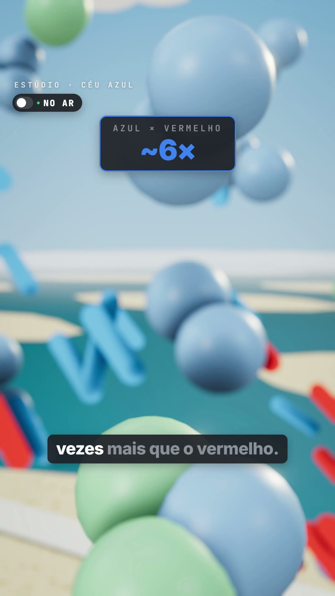
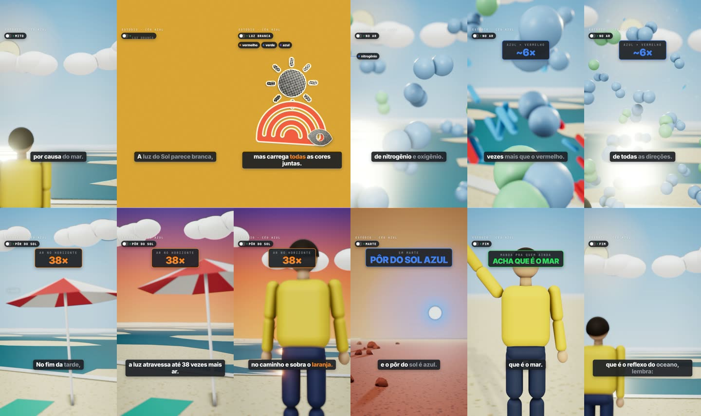

# Máquina de Reels

Transforma um prompt num **reel vertical cíclico** (o fim emenda no começo, e o vídeo fica rodando em loop sem corte), no estilo dos explicadores 3D curtos:

**prompt → menu de montagem → roteiro com fontes → você aprova → voz → trilha e efeitos → mixagem em loop → storyboard → mundo 3D e colagens → checagem → render → QA do loop → agente revisor → sua revisão cena a cena → MP4**

É um "frankenstein" honesto: um motor em Node (`motor/rs.mjs`), um painel web local, um kit 3D em three.js renderizado pelo [HyperFrames](https://github.com/heygen-com/hyperframes), e um modelo de linguagem que escreve o roteiro, o storyboard e o código de cada cena. O modelo pode ser:

| Modo | Como funciona | Custo |
|---|---|---|
| **Claude Code** (padrão) | Você conversa com o Claude Code na pasta do projeto; ele segue o `SKILL.md`. | Sai da sua assinatura do Claude (Pro/Max). |
| **API da Anthropic** | O painel opera tudo sozinho com Claude via chave de API. | Por token (veja [Custos](#custos-médios-por-vídeo)). |
| **API compatível com OpenAI** | Mesmo fluxo com OpenAI, OpenRouter, Groq, Ollama, LM Studio… | Depende do provedor (Ollama local = grátis). |

<p align="center"> </p>
<p align="center"><sub>Exemplo incluído em <code>exemplos/ceu-azul/</code>: "Por que o céu é azul" (roteiro, storyboard e o mundo 3D completo).</sub></p>

---

## Requisitos

- **Node 22+** e **git**
- **Python 3.10+** (alinhamento de voz, voz offline, transcrição)
- **ffmpeg** e **ffprobe** no PATH
- Chrome/Chromium (o HyperFrames usa para renderizar; o `npm install` cuida disso)
- Opcional: chave da **ElevenLabs** (voz, música e efeitos). Sem ela, tudo roda offline: voz Kokoro e trilha/efeitos sintetizados pelo lemo-opuscar.

Testado no Windows 11; o código é multiplataforma (macOS/Linux devem funcionar; relate problemas).

## Instalação

```bash
git clone https://github.com/Fabio-araujo-silva/maquina-de-reels.git
cd maquina-de-reels
npm install
npm run setup      # clona os externos, cria o .venv, baixa a voz offline, cria o .env e roda o diagnóstico
npm run painel     # http://127.0.0.1:4777
```

O `npm run setup` termina com o `doctor`. Tudo com ✓ = pronto. As chaves vão no `.env` (ou no painel, em **Configurações → Chaves**). O `.env` nunca sai da sua máquina.

## Como usar

### Modo 1: Claude Code (padrão)

1. Abra o Claude Code **na pasta do projeto** (`claude` no terminal).
2. Para o Claude achar a skill, deixe a pasta acessível como skill pessoal. Uma das opções:
   - Windows: `mklink /J "%USERPROFILE%\.claude\skills\estudio-de-reels" "C:\caminho\maquina-de-reels"`
   - macOS/Linux: `ln -s "$(pwd)" ~/.claude/skills/estudio-de-reels`
3. Peça: **"faz um reel sobre por que o céu é azul"** (ou cole um link do YouTube: "faz um reel sobre este vídeo").
4. O Claude pergunta o **menu de montagem** (duração, estrutura, tom, estilo, voz, música…), escreve o roteiro **com fontes** e para para você aprovar, no chat ou no painel.
5. Depois da aprovação, ele produz sozinho. No fim, você revisa **cena a cena** no painel (`/#/v/<id>/revisar`) e aprova a entrega.

Para usar só o painel: crie o vídeo em **Novo vídeo** e diga ao Claude **"opera o painel"**. Ele fica escutando a fila.

### Modo 2: por API (sem Claude Code)

1. Painel → **Configurações → Modelo**: escolha **API da Anthropic** ou **API compatível com OpenAI**.
   - Anthropic: modelo (`claude-opus-5-5`, `claude-sonnet-5-5`, `claude-haiku-5-5`…), esforço e busca na web.
   - OpenAI-compatível: endereço base e modelo. Exemplos:
     - OpenAI: `https://api.openai.com/v1`
     - OpenRouter: `https://openrouter.ai/api/v1` (aí dá para usar quase qualquer modelo, inclusive Claude)
     - Ollama: `http://localhost:11434/v1` · LM Studio: `http://localhost:1234/v1`
2. Em **Configurações → Chaves**, cole `ANTHROPIC_API_KEY` ou `OPENAI_API_KEY` (Ollama local não precisa).
3. Salve. O painel sobe sozinho o **operador por API** (`rs agente --fila`), e daí em diante:
   - **Novo vídeo** → o modelo escreve o roteiro → você aprova no painel → ele produz → você revisa as cenas → entrega.
   - No terminal, para um vídeo específico: `node motor/rs.mjs agente <id>`.

O agente por API só enxerga a pasta do projeto: lê e escreve arquivos ali e roda o motor `rs`. Ele não aprova nada por você e tem uma trava de custo (**limite de passos por etapa**, em Configurações → Modelo). O log fica em `dados/operador-api.log` e o consumo por etapa em `videos/<id>/tokens_api.json`.

> Modelos pequenos e locais costumam escrever o roteiro e o storyboard bem, mas têm dificuldade com o mundo 3D (código three.js longo) e com a checagem visual (precisam enxergar imagens). Para vídeos completos, prefira um modelo forte com visão.

## Custos médios por vídeo

Números reais de 6 vídeos de 39 a 87 s feitos com Claude Code (Claude Opus), medidos pelos transcripts (`rs tokens`):

| | Típico | Faixa observada |
|---|---|---|
| Mensagens do modelo | ~150 | 63 – 263 |
| Tokens totais | 30 – 50 milhões | 7 – 126 milhões |
| ...dos quais leitura de cache | **~97%** | |
| Tokens de saída | ~250 mil | 45 mil – 500 mil |
| Custo equivalente na API (Opus 5.5) | **US$ 15 – 20** | US$ 4 – 42 |
| ElevenLabs (voz, eleven_v3) | ~300 – 450 créditos | + música e efeitos (efeitos são gerados uma vez e reaproveitados) |
| Tempo de ponta a ponta | 30 – 60 min | render de 1080p30 leva alguns minutos |

- No **Claude Code com assinatura**, você não paga por token: o consumo sai do limite do plano. A tabela serve de referência para o modo API.
- Os vídeos mais caros (US$ 37 a 42) foram os primeiros, com muitas idas e vindas, peças novas no kit e duas rodadas completas do revisor. Um vídeo "de linha" fica perto de US$ 4 a 18.
- Por etapa, o grosso vai para o **roteiro** (pesquisa) e para a **montagem do mundo 3D** (código + conferência de quadros).
- O painel mostra tokens e custo de cada vídeo na aba **Custos** e o total em **Uso e custos**.

## Como economizar tokens

1. **Modelo e esforço**: no modo API, `claude-sonnet-5-5` custa metade do Opus por token e dá conta da maioria dos vídeos. Use `high` em vez de `xhigh`/`max`.
2. **Revisor**: cada rodada do agente revisor = um parecer + correções + um render novo. Em Configurações → Legenda e render, deixe **1 rodada**, ou escolha **"Só relatório"**/**"Sem revisor"** no menu.
3. **Duração**: 30–45 s custa bem menos que 60–90 s (menos falas = menos planos, menos código).
4. **Estilo**: `diorama-3d` puro reaproveita mais o kit que o estilo `dinamico` com 3 estilos (cada estilo 3D é um mundo a escrever).
5. **Rascunho primeiro**: qualidade **Rascunho 540p** no menu para testar a ideia; renderize em 1080p só o que valer.
6. **Prévia**: "Sim, parar na prévia" no menu evita renderizar algo que você vai pedir para mudar.
7. **Reaproveite o kit**: personagens e objetos criados para um tema (camisa de time, urubu, carro de F1…) ficam em `kit/` e não são escritos de novo.
8. **Cache**: o fluxo foi desenhado para cache. O SKILL.md e as instruções ficam estáveis, e é por isso que ~97% dos tokens são leitura de cache (10× mais barata). Evite editar o SKILL.md no meio de um vídeo.
9. **ElevenLabs**: uma única chamada de TTS por vídeo (o roteiro inteiro). Os efeitos ficam na biblioteca e só são gerados uma vez. Sem chave, tudo vai para o offline.

## O painel

`npm run painel` → http://127.0.0.1:4777

- **Vídeos**: estágio de cada vídeo, o que o modelo está fazendo agora, roteiro, mídia, quadros, parecer do revisor, custos e log.
- **Novo vídeo**: prompt ou link do YouTube, com o menu já respondido.
- **Revisar**: assista e marque cada cena como boa ou peça mudança. Aprovar entrega o vídeo.
- **Configurações**: voz (inclusive criar uma voz pt-BR nativa no Voice Design da ElevenLabs), menu padrão, marca, áudio, legenda e render, **modelo** (Claude Code / API), chaves, módulos do pipeline e diagnóstico.

## Comandos (`node motor/rs.mjs …`)

```
doctor                      verifica dependências e chaves
novo "<prompt>"             cria um vídeo        lista / status <id> / proximo <id>
menu <id> --padrao          aceita os padrões do menu
roteiro <id> --validar      valida o roteiro     roteiro <id> --publicar
auto <id>                   roda tudo o que é do motor até precisar do modelo ou de você
agente <id>                 modo API: leva o vídeo até a entrega
agente --fila               modo API: operador da fila do painel
quadros <id>                tira quadros do projeto para conferir
tokens [<id>]               recalcula tokens e custo por vídeo
painel                      sobe o painel
```

Lista completa: `node motor/rs.mjs ajuda`.

## Estrutura

```
SKILL.md          protocolo que o modelo segue (o mesmo nos dois modos)
LEIA-ME.md        detalhes técnicos: módulos, como trocar/adicionar um estágio
motor/            CLI rs.mjs, estado, menu, validação do roteiro, fila, tokens, agente por API, instalador
modulos/<etapa>/  um módulo por estágio (run.mjs + docs para o modelo)
kit/              biblioteca 3D copiada para cada vídeo: palco, câmera, personagem, cenários, rótulos, colagem
estilos/          estilos da casa (diorama-3d, colagem-halftone)
painel/           servidor Node sem dependências + front
config/           menu, padrões, pipeline, preços, executor (modelo)
exemplos/         um vídeo de exemplo completo (sem o MP4)
externos/         lemo-opuscar e gbro-collage-broll (clonados pelo setup)
videos/           seus vídeos (fora do git)
```

## Uso responsável

O roteiro exige fonte para todo número e toda afirmação. Se você pedir invenções (humor, sátira), o motor registra isso no roteiro como "inventado a pedido do usuário". Não publique conteúdo inventado como se fosse fato, nem atribua a pessoas reais atos que elas não praticaram.

## Créditos e licenças

- Código deste repositório: **MIT** (veja `LICENSE`).
- [HyperFrames](https://github.com/heygen-com/hyperframes): render HTML → MP4 (dependência npm).
- [lemo-opuscar](https://github.com/lemomo-ai/lemo-opuscar) (MIT, LemoLab): 66 estilos, profundidade de campo e síntese de trilha e foley.
- [gbro-collage-broll](https://github.com/pyang5166/gbro-collage-broll) (MIT, 狗哥笔记): estética da colagem halftone.
- [three.js](https://threejs.org), [GSAP](https://gsap.com), [Phosphor Icons](https://phosphoricons.com), [Kokoro](https://github.com/thewh1teagle/kokoro-onnx) (voz offline), [faster-whisper](https://github.com/SYSTRAN/faster-whisper).
- Voz, música e efeitos opcionais: [ElevenLabs](https://elevenlabs.io) (sua chave, seu plano).
